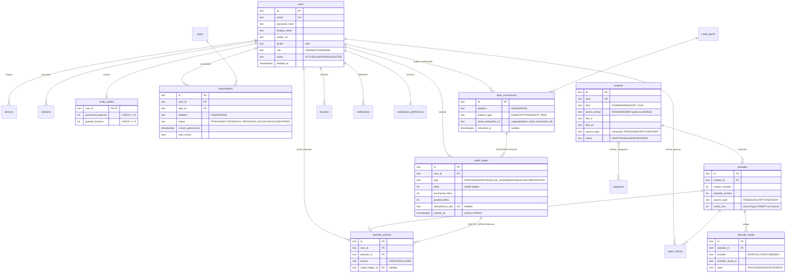

# PerdeGo — Veritabanı Şeması ve ER Diyagramı (ERD)

> Sürüm: 1.0 · Tarih: 2026-10-25 · PostgreSQL 16 + Prisma ORM
> Varlık adları İngilizce (Genel Kural 6); tüm metin kolonları için varsayılan
> yerelleştirme yaklaşımı `*_tr` / `*_en` çift kolonudur.

## 1. Alan İlkeleri

1. **Kimlikler:** Prisma varsayılanı yerine uygulama üretimi `cuid()` (`id text PK`).
2. **Zaman:** `timestamptz`, UTC. API'de ISO-8601 metni (contracts uyumlu).
3. **Para:** `numeric(12,2)` + `currency char(3)`. Kredi bakiyeleri `integer`
   (negatif olamaz; `CHECK` kısıtı).
4. **Ledger dövmez:** `credit_ledger` üzerinde UPDATE/DELETE yapılmaz — Prisma
   modelinde yalnızca `create` erişimi + DB rolü üzerinden yazma hakkı kısıtlı
   ayrı bir PostgreSQL rolü kullanılır (BR-04).
5. **Yumuşak silme:** `contents`, `episodes` için `status` (DRAFT/PUBLISHED/ARCHIVED);
   `users.deletedAt` anonimleştirme zamanını işaretler (BR-11).
6. **Tüm yabancı anahtarlar** `ON DELETE RESTRICT` (finansal ve izleme verisi)
   ya da açıkça `CASCADE` (sahiplik ilişkileri) — tablo listelerinde tek tek
   belirtilmiştir.

## 2. ER Diyagramı (Mermaid)

## 3. Tablo Tanımları

### 3.1 Kimlik ve Cihaz

**users** — hesap kökü.
| Kolon | Tip | Not |
|-------|-----|-----|
| id | text PK | cuid |
| email | text UNIQUE NOT NULL | küçük harf normalize |
| password_hash | text NULL | argon2id; sosyal girişte null (P fazı) |
| display_name | text NOT NULL | 1–60 |
| avatar_url | text NULL | |
| locale | text NOT NULL DEFAULT 'tr' | `tr|en` |
| role | text NOT NULL DEFAULT 'USER' | `USER|EDITOR|ADMIN` |
| status | text NOT NULL DEFAULT 'ACTIVE' | `ACTIVE|SUSPENDED|DELETED` |
| birth_year | int NULL | 18+ içerik kontrolü (PRD §8) |
| created_at / updated_at / deleted_at | timestamptz | deleted_at anonimleştirme mührü |

İndeks: `(email)` unique; `(status)`.

**sessions** — refresh token rotasyonu ve geri çağırma.
| Kolon | Tip | Not |
|-------|-----|-----|
| id | text PK | |
| user_id | text FK→users CASCADE | |
| refresh_token_hash | text UNIQUE | SHA-256; ham token DB'ye yazılmaz |
| device_id | text FK→devices NULL | |
| ip_hash, user_agent | text | PII minimize: ip hash'li |
| expires_at | timestamptz | 30 gün |
| revoked_at, replaced_by | text/timestamptz | reuse-detection zinciri |

**devices** — push token'ları.
`id PK; user_id FK; platform IOS|ANDROID; push_token text UNIQUE; app_version; locale; last_active_at; created_at`. İndeks: `(user_id)`, `(push_token)` unique.

### 3.2 Katalog

**categories** — `id PK; slug UNIQUE; name_tr; name_en; sort_order int; is_active bool`.

**contents** — film/dizi/kısa film kökü.
| Kolon | Tip | Not |
|-------|-----|-----|
| id | text PK | |
| slug | text UNIQUE | kebab-case (contracts regex) |
| kind | text NOT NULL | `FILM|SERIES|SHORT_FILM` |
| series_format | text NULL | `STANDARD|MINI`; yalnızca `SERIES` (mini dizi) |
| title_tr / title_en, original_title, synopsis_tr/en, tagline_tr/en | text | |
| release_year | int | 1890–2100 |
| age_rating | text NULL | `7+|13+|16+|18+` |
| duration_seconds | int NULL | FILM/SHORT_FILM |
| poster_url, hero_image_url, vertical_preview_url | text NULL | 2:3 / 16:9 / 9:16 |
| default_access_type | text | bölüm bazlı erişimin varsayılanı |
| status | text | `DRAFT|PUBLISHED|ARCHIVED` |
| published_at | timestamptz NULL | |
| created_by | text FK→users | admin denetimi |
| created_at / updated_at | timestamptz | |

İndeks: `(status, published_at DESC)`, `(kind)`. Kısıt: `SERIES` ise `series_format NOT NULL`; `SHORT_FILM` tam 1 bölüm (trigger/check).

**content_categories** — `content_id FK CASCADE; category_id FK; PRIMARY KEY(content_id, category_id)`.

**episodes** — bölüm.
| Kolon | Tip | Not |
|-------|-----|-----|
| id | text PK | |
| content_id | text FK→contents CASCADE | |
| season_number / episode_number | int NOT NULL | `UNIQUE(content_id, season_number, episode_number)` |
| title_tr/en, synopsis_tr/en | text | |
| duration_seconds | int NOT NULL | |
| vertical_preview_url | text NULL | 9:16 |
| access_type | text NOT NULL | `FREE|SUBSCRIPTION|CREDIT` |
| credit_cost | int NULL CHECK (credit_cost > 0) | `CREDIT` için zorunlu (CHECK) |
| status | text | `DRAFT|SCHEDULED|PUBLISHED|ARCHIVED` |
| published_at, free_until_at | timestamptz NULL | `free_until_at` "önce ücretsiz" kampanya alanıdır — **MVP'de kullanılmaz** (Faz 5+ kararı); oynatma kararında MVP'de yalnızca `access_type` esas alınır |
| created_at / updated_at | timestamptz | |

**episode_media** — sağlayıcı asset kaydı (sağlayıcı bağımsızlığı, D5).
`id PK; episode_id FK→episodes CASCADE; provider BUNNY|CLOUDFLARE|MUX; provider_asset_id; state PROCESSING|READY|ERROR; duration_seconds; error_message; created_by_upload_id; created_at/updated_at`.
İndeks: `(episode_id, state)`; aynı anda tek `READY` olmalı (kısmi unique index `WHERE state='READY'`).

### 3.3 İzleme ve Favoriler

**watch_history** — `id PK; user_id FK CASCADE; episode_id FK→episodes; content_id FK→contents (denormalize, sorgu hızlandırmaya); position_seconds int NOT NULL; completed bool DEFAULT false; last_watched_at timestamptz`.
`UNIQUE(user_id, episode_id)`. İndeks: `(user_id, last_watched_at DESC)` — "devam et" rayı.

**favorites** — `id PK; user_id FK CASCADE; content_id FK→contents CASCADE; created_at`. `UNIQUE(user_id, content_id)`.

**playback_sessions** — aktif oynatma oturumları (SECURITY §4: imzalı URL
`assetId+exp` taşır; kullanıcı/oturum bağlantısı bu tabloda tutulur;
paralel oynatma limiti burada sayılır).
`id PK; user_id FK→users CASCADE; episode_id FK→episodes; device_id FK→devices NULL;
issued_at; expires_at (issued + 300 sn); revoked_at NULL; last_seen_at`.
İndeks: `(user_id) WHERE revoked_at IS NULL` — paralel oturum sayacı;
`(episode_id, issued_at DESC)` — kötüye kullanım analizi. Süresi geçen
oturumlar günlük temizlik job'ı ile silinir (PII minimize).

### 3.4 Monetizasyon

**plans** — abonelik ürünleri.
`id PK; code UNIQUE (SUB_MONTHLY|SUB_YEARLY); title_tr/en; platform_product_id_ios; platform_product_id_appstore_unique; platform_product_id_android; billing_period MONTH|YEAR; grace_period_days int DEFAULT 16; is_active bool; created_at`.
Kısıt: aynı `billing_period` için en fazla bir `is_active` plan.

**subscriptions** — kullanıcı abonelik durum makinesi.
| Kolon | Tip | Not |
|-------|-----|-----|
| id | text PK | |
| user_id | text FK→users | |
| plan_id | text FK→plans | |
| platform | text | `IOS|ANDROID` |
| status | text | `TRIALING|ACTIVE|GRACE_PERIOD|ON_HOLD|CANCELED|EXPIRED` |
| auto_renew | bool | |
| current_period_start / current_period_end | timestamptz | BR-02 kontrolü bu alana bakar |
| store_original_transaction_id | text | mağaza kimliği (platform + unique) |
| product_id | text | mağazadaki ürün kimliği |
| price / currency | numeric/char | son bilinen fiyat |
| canceled_at / expires_at | timestamptz NULL | |
| created_at / updated_at | timestamptz | |

İndeks: `(user_id, status)`, `(store_original_transaction_id)`.

**store_transactions** — tüm mağaza işlemleri (abonelik yenilemeleri dahil); **BR-06 idempotensin temeli**.
`id PK; user_id FK NULL (webhook ile geç gelen ilk olayda); platform IOS|ANDROID; product_type SUBSCRIPTION|CREDIT_PACK; product_id; store_transaction_id; store_original_transaction_id; purchase_token text (Android); quantity int DEFAULT 1; price numeric(12,2); currency char(3); purchase_state PURCHASED|REFUNDED|REVOKED; validated_at; refunded_at; raw_payload jsonb (mağaza yanıtı özeti)`.
`UNIQUE(platform, store_transaction_id)`. İndeks: `(user_id, created_at DESC)`.

**credit_packs** — `id PK; code UNIQUE (PACK_10|PACK_25|PACK_60…); credits int; bonus_credits int DEFAULT 0; platform_product_id_ios/android; price numeric; currency char(3); is_active bool; sort_order`.

**credit_wallets** — ledger'dan türetilen önbellek (tek doğru: ledger).
`user_id PK/FK; purchased_balance int CHECK >= 0; granted_balance int CHECK >= 0; updated_at`. Wallet satırı `SELECT … FOR UPDATE` ile kilitlenir (ARCHITECTURE §4).

**credit_ledger** — **append-only dövmez** (BR-04).
| Kolon | Tip | Not |
|-------|-----|-----|
| id | text PK | |
| user_id | text FK→users RESTRICT | hesap silinse de kayıt anonim yaşar |
| type | text | `PURCHASE|GRANT|UNLOCK_SPEND|REFUND|ADJUSTMENT|EXPIRY` |
| delta | int NOT NULL (≠0) | imzalı toplam |
| purchased_delta / granted_delta | int | iki ayrı bakiye bileşeni (BR-05/D7) |
| balance_after_purchased / balance_after_granted | int | yazım anındaki bakiye (denetim) |
| reference_type | text | `STORE_TRANSACTION|EPISODE_UNLOCK|ADMIN_ADJUSTMENT|SUBSCRIPTION|EXPIRY_JOB` |
| reference_id | text | ilgili tablo satırı |
| idempotency_key | text UNIQUE NULL | BR-06; aynı anahtarla ikinci INSERT imkânsız |
| expires_at | timestamptz NULL | yalnızca `GRANT` (hediye kredi); satın alınanda NULL |
| note | text NULL | admin düzeltmelerinde zorunlu açıklama |
| created_at | timestamptz | |

İndeks: `(user_id, created_at DESC)`; `(type, created_at)`; kısmi index `WHERE expires_at IS NOT NULL` (sona erme job'ı). DB rolü: `perdego_ledger_writer` yalnızca INSERT; uygulama rolü UPDATE/DELETE hakkı yoktur.

**episode_unlocks** — kalıcı bölüm açma hakkı (BR-03).
`id PK; user_id FK RESTRICT; episode_id FK RESTRICT; source CREDIT|INCLUDED; credit_ledger_id FK→credit_ledger NULL (CREDIT ise zorunlu); store_transaction_id FK NULL; created_at`.
`UNIQUE(user_id, episode_id)` — ikinci kez ücretlendirme imkânsız (BR-06).

### 3.5 Bildirim ve Operasyon

**notifications** — `id PK; user_id FK CASCADE; type NEW_EPISODE|NEW_CONTENT|PROMO|SYSTEM; title_tr/en; body_tr/en; data_json jsonb (deep-link); push_sent_at NULL; read_at NULL; created_at`. İndeks: `(user_id, created_at DESC)`, kısmi `(user_id) WHERE read_at IS NULL`.

**notification_preferences** — `user_id PK/FK; new_episode bool; new_content bool; promo bool; system bool (salt okunur true); updated_at`.

**webhook_events** — ham mağaza olayları (idempotent işleme girdisi).
`id PK; source APPLE|GOOGLE|REVENUECAT; event_type; event_id; signature_valid bool; payload jsonb; state RECEIVED|PROCESSED|FAILED|SKIPPED; error_message; received_at; processed_at`. `UNIQUE(source, event_id)`.

**idempotency_keys** — genel istek idempotensi (BR-06).
`key text PK (client sağlar); user_id; endpoint; request_hash; response_status; response_body jsonb; created_at; expires_at (24h, job temizler)`.

**audit_logs** — admin eylemleri (F-54 kredi düzeltmesi dahil).
`id PK; actor_user_id FK; action (örn. CREDIT_ADJUSTMENT, CONTENT_PUBLISH); entity_type; entity_id; before_json/after_json jsonb; ip_hash; created_at`. İndeks: `(entity_type, entity_id, created_at DESC)`.

## 4. Ana Akışların Şema İzleri

1. **Oynatma yetkisi (BR-02/07):** `episodes.access_type` → `subscriptions(current_period_end > now() AND status IN (ACTIVE, TRIALING, GRACE_PERIOD))` → `episode_unlocks` → `playback_sessions` (paralel limit ≤ 2) → `watch_history(position_seconds)`.
2. **Krediyle açma (BR-03/04/06):** `credit_wallets` (FOR UPDATE) → `credit_ledger` (INSERT) → `episode_unlocks` (INSERT) — tek transaction.
3. **İade (BR-12):** `webhook_events` → `store_transactions.refunded_at` → `credit_ledger(REFUND, negatif)` ve/veya `subscriptions.status=EXPIRED`.
4. **Hesap silme (BR-11):** `users.deleted_at` set → `devices`/`sessions` silinir → PII kolonları anonimleştirilir → `credit_ledger` ve `store_transactions` **anonim yaşar** (yasal muhafaza; kullanıcı kimliği `anon:<hash>`).

## 5. Geçiş ve Sürümleme

- Prisma migration dosyaları `apps/api/prisma/migrations` altında sürümlenir;
  geri alınabilir migration yazılmaz — ileri-uyumlu düzeltme migration'ı
  tercih edilir.
- Şema değişikliği `packages/contracts`'taki şemaları etkiliyorsa her ikisi
  aynı PR'da güncellenir ve sözleşme testleri (vitest) koşulur.
